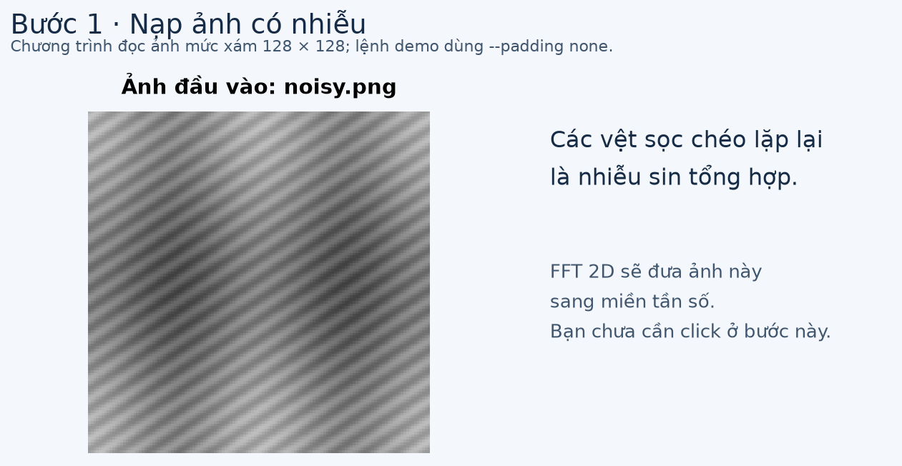
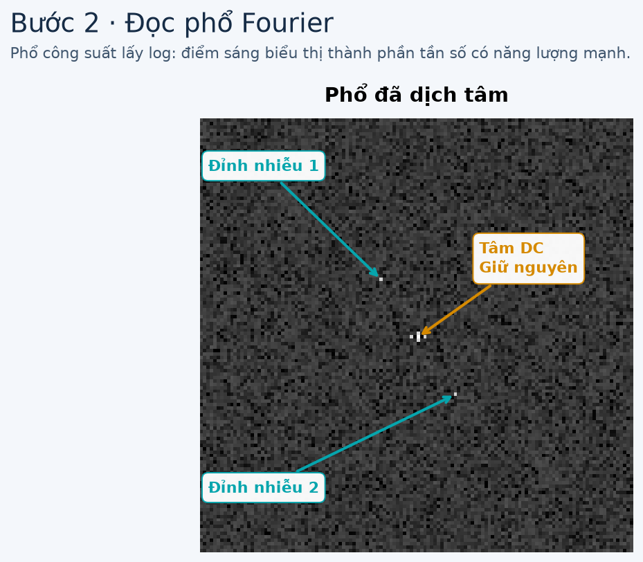
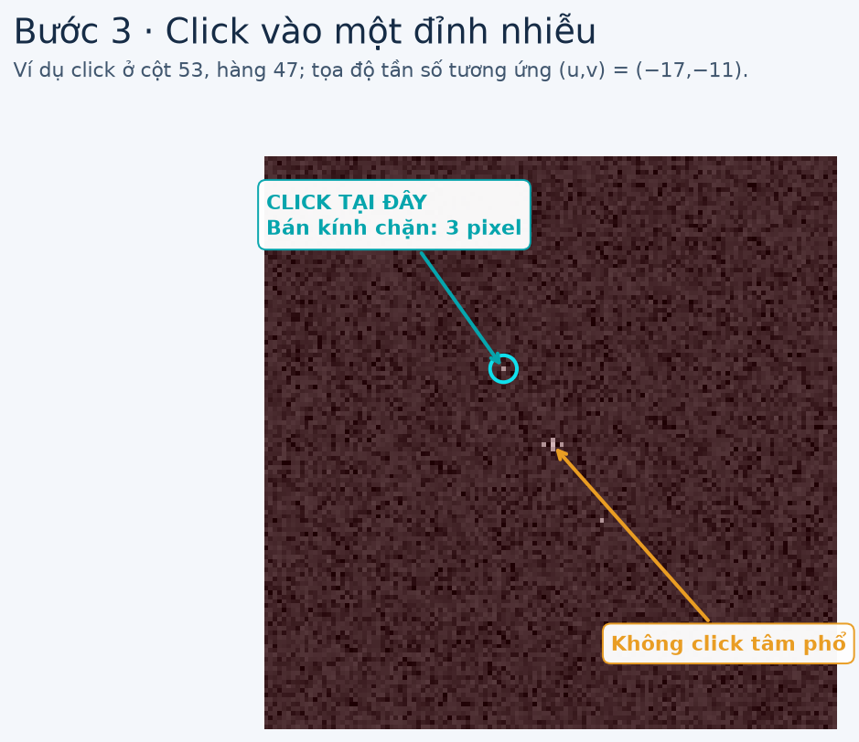
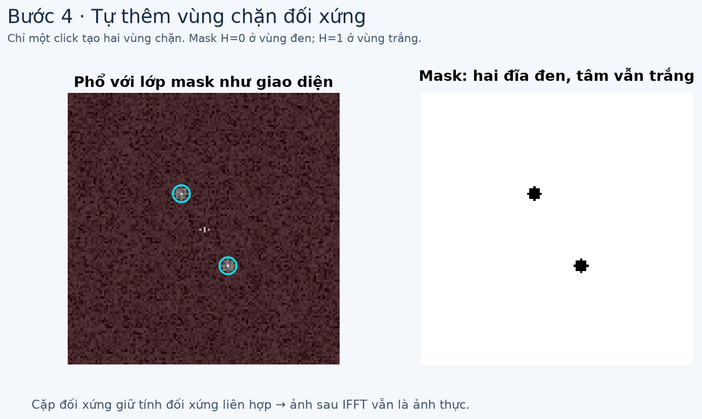
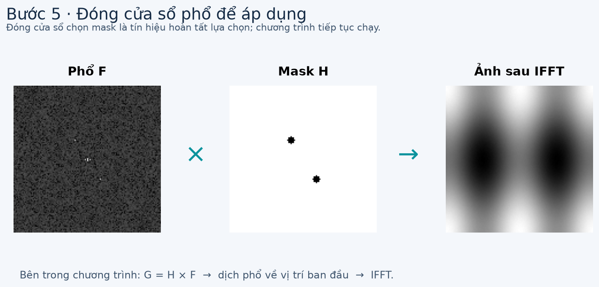
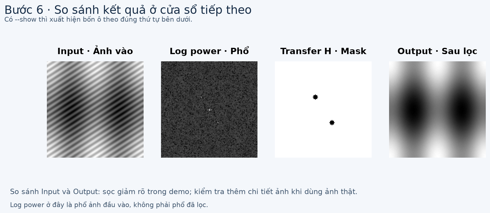
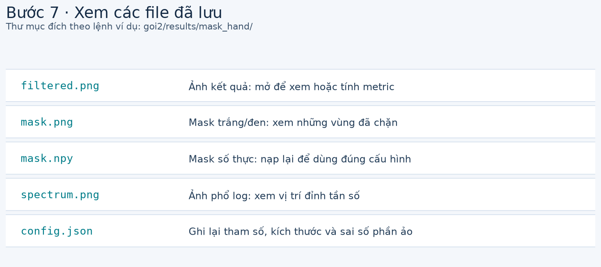

# Minh họa thao tác masking qua CLI

Đây là hướng dẫn cửa sổ Matplotlib của CLI. Giao diện Flutter hiện tại dùng nút
**Xem trước** thay vì đóng cửa sổ. Xem `../../flutter_app/README.md` để dùng Flutter.

Ảnh minh họa từ dữ liệu demo thật, không phải ảnh chụp màn hình hệ điều hành.
Tọa độ minh họa chỉ áp dụng cho ảnh demo 128×128, không padding.

## Bước 1. Nạp ảnh có nhiễu

## Bước 2. Quan sát phổ Fourier

## Bước 3. Click một đỉnh nhiễu

## Bước 4. Tự chặn vùng đối xứng

## Bước 5. Đóng cửa sổ phổ để áp dụng

## Bước 6. Xem kết quả lọc

## Bước 7. Mở các file đã lưu

